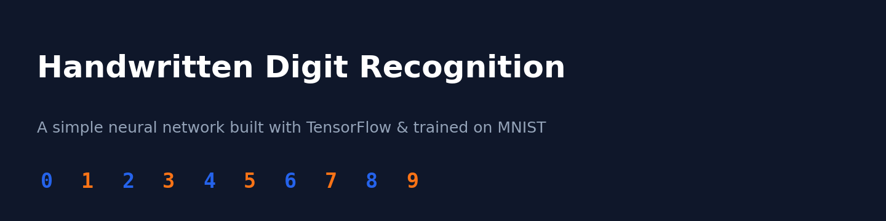
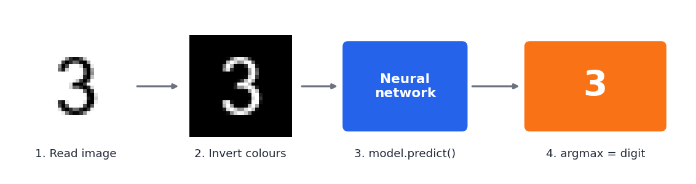
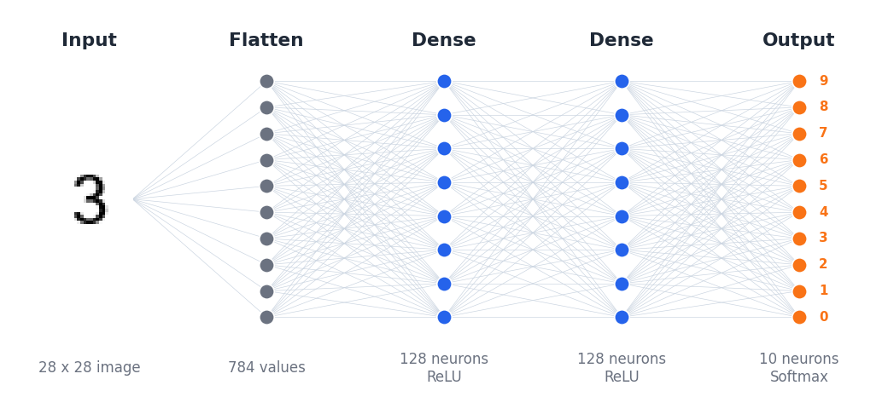
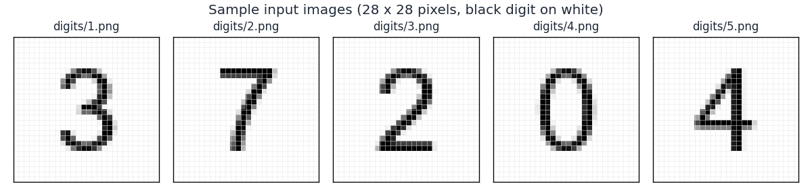

<p align="center">
  
</p>

<p align="center">
  
  
  
  
</p>

A beginner-friendly project that teaches a computer to **read handwritten digits (0–9)**.
A small neural network is trained on the famous **MNIST** dataset (70,000 handwritten digits) and then used to recognize digits from your own images.

---

## Table of Contents

- [How It Works](#how-it-works)
- [The Neural Network](#the-neural-network)
- [Project Structure](#project-structure)
- [Getting Started](#getting-started)
- [Use Your Own Digits](#use-your-own-digits)
- [Code Walkthrough](#code-walkthrough)
- [Ideas for Improvement](#ideas-for-improvement)

---

## How It Works

<p align="center">
  
</p>

1. **Read the image:** a 28×28 PNG is loaded with OpenCV.
2. **Invert the colours:** MNIST digits are *white on black*, but we draw *black on white*, so the image is flipped to match what the model learned.
3. **Predict:** the image goes through the trained neural network, which outputs 10 probabilities (one for each digit).
4. **Pick the answer:** `np.argmax` chooses the digit with the highest probability.

---

## The Neural Network

<p align="center">
  
</p>

| Layer   | Size        | Activation | What it does                                         |
|---------|-------------|------------|------------------------------------------------------|
| Input   | 28 × 28     | –          | The grayscale image of a digit                       |
| Flatten | 784         | –          | Turns the 2D image into a single row of 784 pixels   |
| Dense   | 128         | ReLU       | Learns simple patterns (strokes, curves)             |
| Dense   | 128         | ReLU       | Combines them into more complex shapes               |
| Output  | 10          | Softmax    | Gives a probability for each digit 0–9               |

- **Optimizer:** Adam
- **Loss:** Sparse categorical cross-entropy (labels are plain integers 0–9)
- **Training:** 3 epochs over 60,000 images, then tested on 10,000 images it has never seen

> A network this small usually reaches roughly **97% accuracy** on the MNIST test set. Your exact number is printed after training.

---

## Project Structure

```
handwritten-digit-recognition/
├── main.py            # Train the model and predict your digits
├── requirements.txt   # Python dependencies
├── digits/            # Images to recognize (1.png ... 5.png)
└── assets/            # Images used in this README
```

<p align="center">
  
</p>

---

## Getting Started

**1. Clone the repository**

```bash
git clone https://github.com/sailikith5/handwritten-digit-recognition-using-tensorflow.git
cd handwritten-digit-recognition-using-tensorflow
```

**2. Install the dependencies**

```bash
pip install -r requirements.txt
```

**3. Run it**

```bash
python main.py
```

- **First run:** downloads MNIST, trains for 3 epochs, prints the test accuracy and loss, and saves the model as `digits.keras`.
- **Later runs:** load the saved model straight away (no retraining).

For each image in `digits/`, the program prints its guess and shows the image:

```
The result is probably: 3
The result is probably: 7
...
```

> To retrain from scratch, just delete `digits.keras`.

---

## Use Your Own Digits

1. Open **Paint** (or any drawing app) and set the canvas to **28 × 28 pixels**.
2. Draw a digit in **black** on a **white** background. Make it thick and centred.
3. Save it as `1.png`, `2.png`, … `5.png` inside the `digits/` folder.
4. Run `python main.py` again.

---

## Code Walkthrough

```python
# Load and scale the data so pixel values are between 0 and 1
(x_train, y_train), (x_test, y_test) = tf.keras.datasets.mnist.load_data()
x_train = tf.keras.utils.normalize(x_train, axis=1)

# Build the network
model = tf.keras.models.Sequential()
model.add(tf.keras.layers.Input(shape=(28, 28)))
model.add(tf.keras.layers.Flatten())
model.add(tf.keras.layers.Dense(units=128, activation=tf.nn.relu))
model.add(tf.keras.layers.Dense(units=128, activation=tf.nn.relu))
model.add(tf.keras.layers.Dense(units=10, activation=tf.nn.softmax))

# Train and evaluate
model.compile(optimizer='adam', loss='sparse_categorical_crossentropy', metrics=['accuracy'])
model.fit(x_train, y_train, epochs=3)
loss, accuracy = model.evaluate(x_test, y_test)

# Predict a custom image
img = cv.imread('digits/1.png')[:, :, 0]   # keep one colour channel
img = np.invert(np.array([img]))           # black-on-white -> white-on-black
prediction = model.predict(img)
print(np.argmax(prediction))               # the most likely digit
```

---

## Ideas for Improvement

- Use a **Convolutional Neural Network (CNN)** for higher accuracy (~99%).
- Train for more epochs and add **Dropout** to reduce overfitting.
- Build a small **drawing app** (Tkinter / Streamlit) to draw digits and predict them live.
- Automatically **resize and centre** any image to 28×28 before predicting.

---

<p align="center">Built with ❤️ using TensorFlow</p>
